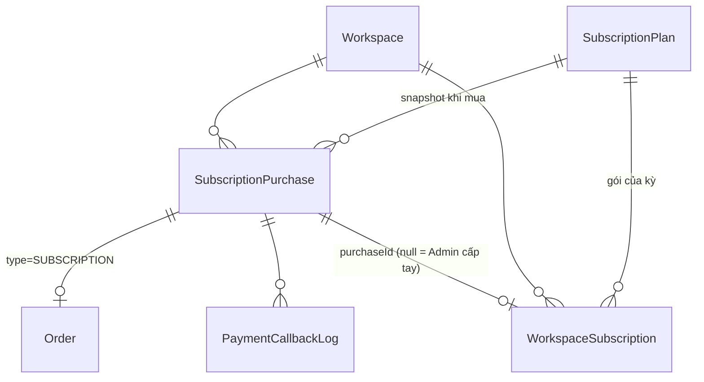

# Subscription — Component Design

Module `src/subscriptions/` (thêm 2026-11-23, SUB-01). Rule nghiệp vụ: `BR-SUB-01 … BR-SUB-06`, `BR-CORE-10`. Contract FE: `docs/FRONTEND_API_GUIDE_NEXTJS.mdc` mục 9B, `docs/FRONTEND_ADMIN_ROUTER_API_MAP.mdc` mục 8A.

## Quyết định thiết kế

| Quyết định | Lý do |
|---|---|
| Entity riêng `SubscriptionPurchase` thay vì dùng chung `TopupRequest` | Topup cộng ví và gắn `Order` 1-1; subscription không cộng ví. Tách để không làm lẫn counter ví và để webhook phân biệt rõ loại đơn. |
| Tách `SubscriptionPlan` / `SubscriptionPurchase` / `WorkspaceSubscription` | Plan = catalog Admin sửa được; Purchase = đơn chờ thanh toán có snapshot tên/giá/VAT/thời hạn; WorkspaceSubscription = một **kỳ** có `startsAt/endsAt`, Admin sửa trực tiếp. |
| Mua cộng dồn bằng nhiều kỳ nối tiếp, không sửa kỳ cũ | Giữ lịch sử từng lần mua; kỳ mới bắt đầu tại `max(endsAt)` của các kỳ `ACTIVE` (khóa `FOR UPDATE` dòng `Workspace` để hai đơn trả đồng thời không tính trùng). |
| Hết hạn suy ra từ `endsAt`, không cron đổi trạng thái | Enforce chính xác tại thời điểm gửi; cron chỉ dùng cho email nhắc. |
| `Order.type` (`TOPUP`/`SUBSCRIPTION`) + `Order.subscriptionPurchaseId` | Tái dùng màn hình/endpoint order; default `TOPUP` giữ nguyên dữ liệu cũ. |
| Mã đơn `COMVIA_SUB_<8hex>`, nội dung CK `COMVIASUB<8hex>` | Webhook rẽ nhánh theo prefix trước nhánh topup (`COMVIA<8hex>`; hex không chứa "S" nên không nhập nhằng). |
| Tách `Pay2sCollectionService` (`src/integrations/pay2s/`) | Dùng chung cho topup và subscription, không nhân đôi code gọi Pay2S/lưu ảnh QR. |
| Cron bằng `setInterval` trong worker (pattern `CampaignWorkerService`), không thêm `@nestjs/schedule` | Không thêm dependency; mỗi cảnh báo "claim" bằng `updateMany` có điều kiện để nhiều instance không gửi trùng. |
| Campaign đang chạy hết hạn → `PAUSED` + `pauseReason=SUBSCRIPTION_EXPIRED` | Tái dùng cơ chế pause/resume của OA mất kết nối (giữ dòng `PENDING` và tiền đã giữ, resume không trừ lại). |

## ERD (tóm tắt)

- `SystemConfig` thêm `subscriptionExpiryReminderDays` (Int, mặc định 7) và `walletLowBalanceThreshold` (Decimal?, null/0 = tắt).
- `WalletAccount` thêm `lowBalanceEmailSentAt` (DateTime?) để giới hạn 1 email/ngày.
- Migration: `prisma/migrations/20261123100000_subscriptions`.

## Thành phần

| Thành phần | Trách nhiệm |
|---|---|
| `SubscriptionAccessService` | `getStatus` (NONE/ACTIVE/EXPIRED, nối kỳ liền kề), `canSend`, `assertCanSend` (ném `SUBSCRIPTION_REQUIRED`/`SUBSCRIPTION_EXPIRED` dạng `sendErrorBody`). Export cho messaging, public-api, campaigns. |
| `SubscriptionPlansService` | CRUD gói (Admin), list gói đang bán cho workspace, tính VAT/tổng. |
| `SubscriptionPurchasesService` | Tạo đơn + QR, trạng thái đơn, lịch sử. |
| `SubscriptionPaymentsService` | Xử lý IPN / bank webhook của đơn subscription (idempotent): log callback → `PENDING→PAID` → khóa workspace → tính kỳ → tạo Order + `WorkspaceSubscription` + audit. `TopupsService` ủy quyền sang đây theo prefix. |
| `AdminSubscriptionsService` | List/lọc, cấp tay, sửa kỳ (Admin), audit. |
| `SubscriptionExpiryReminderWorker` | Mỗi giờ: kỳ cuối còn ≤ N ngày, chưa nhắc, không có kỳ nối tiếp → email owner. |
| `WalletLowBalanceWorker` (`src/wallet/`) | Mỗi 5 phút: ví ≤ ngưỡng, chưa nhắc hôm nay (giờ VN), có giao dịch mới kể từ lần nhắc trước → email owner. |
| `EmailService` | Thêm `sendSubscriptionExpiryReminderEmail`, `sendWalletLowBalanceEmail`, `buildAppUrl`. |

## Điểm chặn gửi tin

`MessagingService.sendSingle`, `PublicApiService.sendSingle`, `CampaignsService.execute/retry/resume` và vòng `processCampaignRun` (trước khi claim từng dòng). Luôn đặt **trước** bước kiểm tra/giữ/trừ ví.

## Rủi ro / giới hạn đã biết

- Bật chặn ngay: workspace đang chạy production sẽ không gửi được cho tới khi Admin cấp tay hoặc owner mua gói (PO đã chấp nhận, không backfill).
- Admin sửa `startsAt/endsAt` tạo khoảng trống giữa các kỳ là hợp lệ; `getStatus.endsAt` chỉ nối các kỳ liền kề.
- Đường dẫn FE trong email nhắc (`/app/subscription`, `/app/wallet`) là giả định — cần FE xác nhận.
- Chưa có thanh toán hết hạn tự động cho đơn `PENDING` (giống topup), chưa có hoàn tiền/nâng cấp gói.
