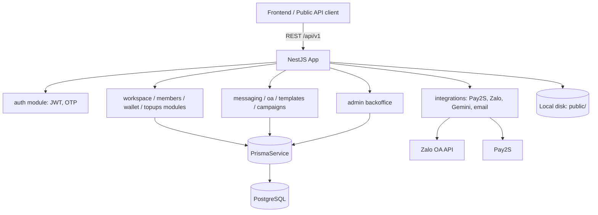

# North Star Architecture — Comvia Backend

> Kiến trúc as-is của backend. Trạng thái triển khai và việc còn lại được theo dõi tại `planning/project-closeout-plan.md`.

## 1. Kiến trúc tổng thể

Comvia là một backend NestJS dạng **modular monolith** (một service duy nhất, chia theo module nghiệp vụ), dùng Prisma/PostgreSQL, JWT auth, tích hợp Zalo OA API, Pay2S (thanh toán). Lưu trữ file (PDF hóa đơn, ảnh OA) dùng đĩa cục bộ dưới `public/`, phục vụ tĩnh qua `/public/`; `@aws-sdk/client-s3` là dependency dự phòng, chưa dùng (xem ADR-002).

## 2. Bảng module (đúng thư mục `src/` hiện tại)

| Module | Trách nhiệm |
|---|---|
| `auth/` | Đăng ký, đăng nhập, OTP, JWT, strategies |
| `admin/` | Admin backoffice |
| `analytics/` | Chỉ số dashboard cấp workspace (read-only, tổng hợp từ MessageLog + Template) |
| `api-keys/` | Quản lý API key theo workspace, Public API |
| `audit-log/` | Ghi log các thao tác nhạy cảm |
| `campaigns/` | Chiến dịch gửi tin hàng loạt |
| `common/` | Guards, interceptors, decorators dùng chung |
| `config/` | Cấu hình, đọc biến môi trường qua `ConfigService` |
| `integrations/` | SDK/util bên thứ 3: `email/`, `gemini/`, `pay2s/`, `zalo/` |
| `members/` | Thành viên workspace, mời/permission |
| `messaging/` | Gửi tin test/single, message log |
| `money-accounts/` | Tài khoản ngân hàng nhận tiền, namespace `default-workspace`; không phải ví credit |
| `oa/` | Kết nối Zalo Official Account |
| `orders/` | Order, invoice |
| `prisma/` | PrismaService và DB client |
| `public-api/` | Endpoint cho hệ thống ngoài dùng API key |
| `quick-chat/` | Code chat/tool theo luật còn tồn tại; PO đã chốt bỏ ngày 2026-10-26, chờ gỡ module/route (không phát triển tiếp) |
| `system-config/` | Cấu hình hệ thống |
| `templates/` | Quản lý template ZNS/ZBS |
| `users/` | Hồ sơ user |
| `workspaces/` | Workspace và billing profile |
| `wallet/` | Ví credit owner, transaction và thống kê theo workspace |
| `topups/` | QR Pay2S, webhook và sinh order/invoice |
| `webhooks/` | Controller nhận webhook Pay2S (đăng ký qua TopupsModule) |

## 3. Quyết định nền tảng

- **Modular monolith, không microservice** — quy mô đội và lưu lượng hiện tại chưa đòi hỏi tách service riêng.
- **Prisma làm ORM duy nhất**, PostgreSQL làm database chính.
- **Auth:** Passport.js + JWT; `JwtAuthGuard` áp dụng toàn hệ thống trừ route `@Public()`; `RolesGuard` cho role `ADMIN`/`USER`/`STAFF`. `WorkspaceContextGuard` lấy workspace từ path, `WorkspaceHeaderGuard` lấy từ `x-workspace-id`; `WorkspaceRolesGuard` kiểm vai trò. ADMIN có bypass membership theo guard; không coi vai trò nghiệp vụ kế toán là enum riêng.
- **Tích hợp bên thứ ba** cô lập trong `src/integrations/`, không gọi trực tiếp từ Controller/Service nghiệp vụ.
- **Giao dịch tiền** (wallet/topup/order) bắt buộc qua `PrismaService.$transaction` — xem `coding-convention.md`.

## 4. Tech stack

| Thành phần | Công nghệ |
|---|---|
| Framework | NestJS v11 |
| Language | TypeScript v5 |
| ORM | Prisma v7 |
| Database | PostgreSQL |
| Auth | Passport.js, JWT, OTP |
| Payments | Pay2S |
| Messaging | Zalo OA API |
| Lưu trữ file | Đĩa cục bộ dưới `public/` (S3 dependency chưa dùng — ADR-002) |
| AI | Gemini trích xuất PDF invoice; Quick Chat hiện là rule-based |
| Validation | class-validator, class-transformer |

## 5. Database — nhóm entity chính (theo `prisma/schema.prisma`)

| Nhóm | Models chính |
|---|---|
| Danh tính | `User`, `UserCredential`, `OtpRequest` |
| Tổ chức | `Workspace`, `WorkspaceMember`, `WorkspaceBillingProfile` |
| Tài chính | `WalletAccount`, `WalletTransaction`, `TopupRequest`, `Order`, `Invoice` |
| Giao tiếp | `WorkspaceOa`, `WorkspaceOaConnection`, `Template`, `MessageLog`, `Campaign` |
| AI/Chat | `QuickChatAgentProfile`, `QuickChatSession`, `QuickChatMessage` |

Chi tiết đầy đủ entity/quan hệ: đọc trực tiếp `prisma/schema.prisma` (nguồn chính xác nhất) khi cần ERD chi tiết cho một phase/feature cụ thể — SA bổ sung `erd.md` theo yêu cầu thực tế thay vì tái tạo toàn bộ schema ở đây.

## 6. Khi nào cần nâng cấp

Campaign hiện thực thi tuần tự trong HTTP request, chưa có durable queue/worker; OA refresh token khi gọi gửi tin, chưa có scheduler health check. OAuth state/PKCE nằm trong `OaOAuthAttempt` (migration 20261012120000), không còn lưu trực tiếp trên connection. Các hạng mục nâng cấp được theo dõi trong project closeout plan.

- Tách microservice riêng cho một module: chỉ khi module đó cần scale độc lập với phần còn lại (ví dụ campaign worker tải cao) — hiện chưa cần.
- Thêm message queue/broker riêng: chỉ khi xử lý bất đồng bộ hiện tại (job nền trong cùng service) không còn đáp ứng được khối lượng.
