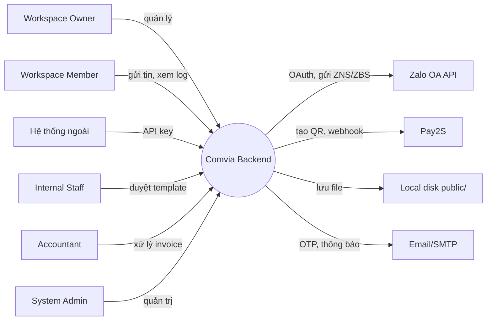

# Business Requirements Document — Comvia

> Tài liệu này được BA tổng hợp lại từ `.cursor/rules/MAIN_RULES.mdc` và `.cursor/rules/project-overview.mdc` (đã xóa sau khi hợp nhất vào đây, tránh hai nguồn sự thật song song), đối chiếu với codebase hiện tại. Đây là tài liệu nghiệp vụ chính thức của dự án từ nay trở đi.

## 1. Tóm tắt dự án

Comvia là một nền tảng SaaS cho phép doanh nghiệp đăng ký tài khoản, tạo workspace, nạp tiền vào ví dưới dạng credit, kết nối Zalo Official Account (OA), tạo và quản lý template ZNS/ZBS, rồi gửi tin nhắn (test/single/chiến dịch) tới khách hàng của họ qua Zalo. Hệ thống đã được xây dựng và đang chạy; công việc hiện tại là vận hành, sửa lỗi và mở rộng theo phản hồi thực tế, không còn ở giai đoạn khởi tạo từ số 0.

## 2. Business Objectives

- Cho phép doanh nghiệp tự vận hành marketing/CSKH qua Zalo OA mà không cần biết chi tiết kỹ thuật API Zalo.
- Đảm bảo dòng tiền (nạp credit, VAT, hóa đơn) minh bạch, đúng luật, có audit đầy đủ.
- Cho phép tích hợp hệ thống ngoài qua Public API (API key theo workspace).
- Vận hành nội bộ (admin, kế toán, duyệt template) gọn, có kiểm soát.

## 3. Stakeholders

| Stakeholder | Vai trò | Kỳ vọng |
|---|---|---|
| Workspace Owner | Chủ sở hữu workspace, chịu trách nhiệm billing/wallet/OA/template/campaign/API key/thành viên | Vận hành gửi tin ổn định, chi phí minh bạch |
| Workspace Member | Thành viên được mời, dùng chung tài nguyên workspace | Thao tác được các nghiệp vụ được owner cấp quyền |
| Guest | Chưa đăng nhập | Đăng ký/đăng nhập/quên mật khẩu suôn sẻ |
| Internal Staff / Reviewer | Duyệt template | Công cụ duyệt rõ ràng, đủ thông tin |
| Accountant | Xử lý hóa đơn | Tra cứu, upload, xuất hóa đơn nhanh, đúng số liệu |
| Billing Operator / Admin | Xử lý topup, giao dịch, điều chỉnh | Công cụ đối soát, xử lý ngoại lệ thanh toán |
| System Admin | Quản trị toàn hệ thống | Kiểm soát user/workspace, quan sát tổng thể |

## 4. Context Diagram

## 5. Dòng giá trị

- **Owner/Member:** tiết kiệm công sức tích hợp trực tiếp API Zalo, có sẵn quản lý credit/billing/campaign.
- **Hệ thống ngoài:** tích hợp gửi tin qua Public API mà không cần tự quản lý token Zalo.
- **Nội bộ (staff/accountant/admin):** công cụ vận hành tập trung cho duyệt template, xử lý hóa đơn, giám sát hệ thống.

## 6. Happy path (mỗi stakeholder một luồng)

- **Owner:** đăng ký → verify OTP → tạo workspace (kèm billing info) → nạp tiền (QR Pay2S) → kết nối Zalo OA → tạo template → submit → được duyệt → gửi test → gửi campaign.
- **Member:** được mời qua email/phone → join workspace → dùng template đã approved để gửi tin (credit trừ vào ví owner).
- **Hệ thống ngoài:** lấy API key từ workspace → gọi Public API gửi tin theo template approved.
- **Staff:** nhận template submitted → duyệt/từ chối kèm lý do.
- **Accountant:** xem invoice `posted` → upload PDF thật → cập nhật `issued`.
- **Admin:** giám sát user/workspace, khóa tài khoản vi phạm.

## 7. Phạm vi

### Trong phạm vi nghiệp vụ (mức triển khai không đồng đều)
14 nhóm: Authentication & Account, User Profile & Security, Workspace Management, Workspace Members & Permissions, Workspace Context & Session, Wallet Credit & Transactions, Topup Payment, Order/Invoice, Zalo OA Connection, ZNS/ZBS Template Management, Messaging (Test/Single/Campaign), API Key & Public API, Admin Backoffice, Notification/Audit Log/Background Jobs. Đây là phạm vi yêu cầu, không phải tuyên bố tất cả đã nghiệm thu. Chi tiết yêu cầu ở `business-rules.md`; phần còn lại và kiểm chứng ở `planning/project-closeout-plan.md`.

### Ngoài phạm vi (tại thời điểm này)
- Nhiều Zalo OA trên một workspace (hiện giới hạn 1 workspace = 1 OA).
- Scheduled campaign (hẹn giờ chạy) — ghi nhận là nên có ở phase sau, chưa triển khai.
- Đổi role thành viên trong workspace (hiện chỉ có Owner/Member cố định) — để dành phase sau.
- Kênh nhắn tin ngoài Zalo OA (SMS/Facebook Messenger...).

## 8. Business Constraints

- Phụ thuộc uptime và rate limit của Zalo OA API và Pay2S.
- Currency chỉ hỗ trợ VND.
- Token Zalo OA có vòng đời hữu hạn, cần refresh job nền.
- Billing info bắt buộc đầy đủ trước khi cho phép topup.

## 9. Non-functional Requirements (mức cao)

- **Idempotency:** mọi webhook thanh toán (Pay2S) phải xử lý idempotent — không cộng credit/tạo order/invoice trùng.
- **Toàn vẹn dữ liệu tiền:** mọi thay đổi số dư ví phải đi qua transaction log, không sửa trực tiếp.
- **Audit:** các thao tác nhạy cảm (billing, member, OA, template, API key, giao dịch) phải có audit log.
- **Bảo mật:** API key lưu dạng hash, chỉ hiển thị đầy đủ một lần lúc tạo.

## 10. Success Metrics

- Tỷ lệ webhook xử lý idempotent thành công 100% (không có double-credit).
- Tỷ lệ gửi tin thành công qua Zalo OA.
- Thời gian xử lý invoice từ `posted` sang `issued`.
- Số lượng issue khách hàng báo được phân loại và xử lý đúng hạn.

## 11. Giả định & câu hỏi mở

- `AS-IS 2026-10-26:` `WalletAccount.ownerUserId` có unique trong schema: một owner dùng chung một ví cho các workspace. Balance/lũy kế ở cấp owner; monthly và danh sách giao dịch hiện lọc theo workspace. Chưa có ví riêng từng workspace; nếu cần là thay đổi sản phẩm mới.
- Các câu hỏi chặn kế hoạch sửa tiếp được theo dõi trong `planning/project-closeout-plan.md` và board.
