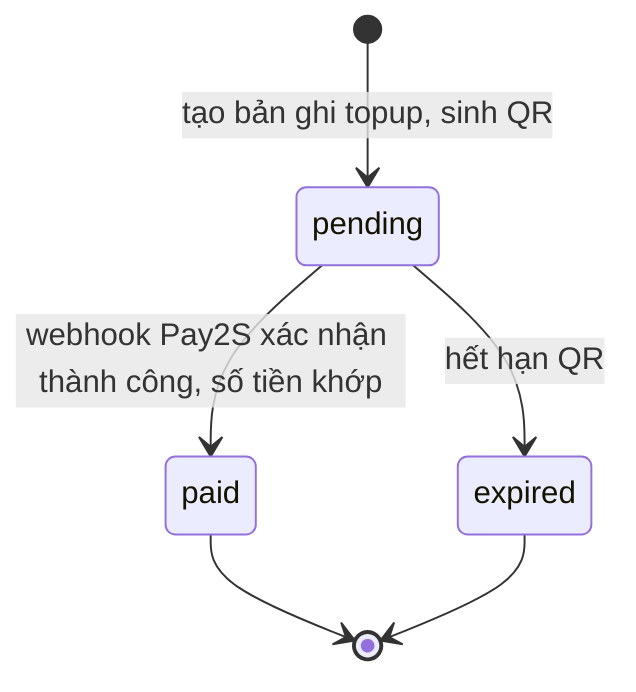
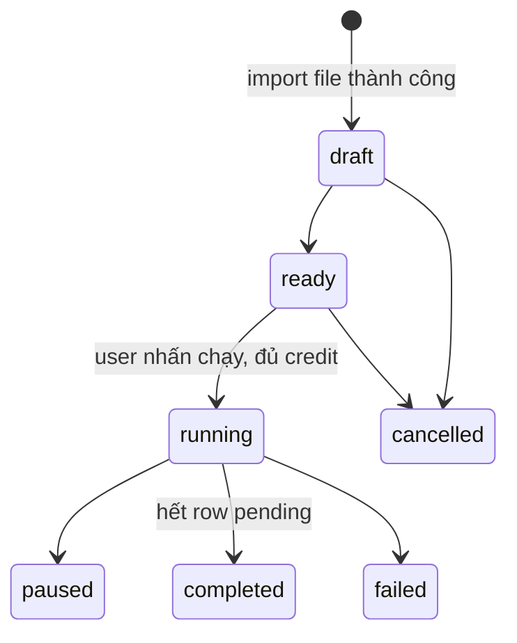
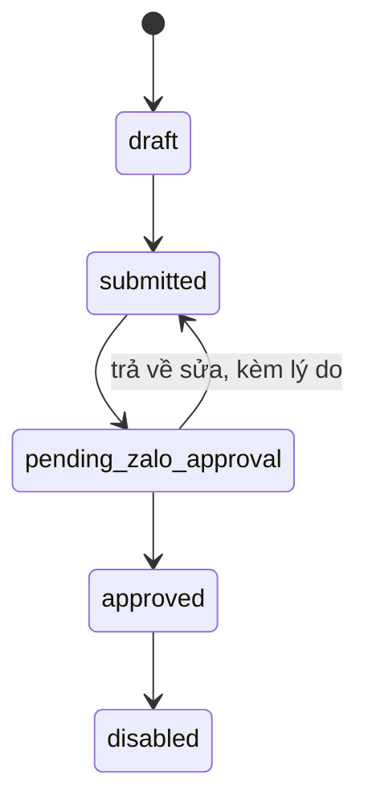

# Business Rules — Comvia

> Đây là nguồn yêu cầu nghiệp vụ. Tiến độ triển khai nằm ở `planning/project-closeout-plan.md` và `tickets/board.md`; không sửa giảm yêu cầu chỉ để khớp một implementation chưa hoàn tất.

> Nguồn sự thật duy nhất cho quy tắc nghiệp vụ của Comvia. Dùng ID dạng `BR-<MODULE>-<seq>` do số lượng module lớn (14 module). Khi PO duyệt Change Request hoặc Missing Spec, sửa trực tiếp rule liên quan tại đây, ghi vào `business/change-log.md` và phát hành handoff cho FE nếu contract bị ảnh hưởng.

## State diagram — vòng đời Topup

## State diagram — vòng đời Campaign

## State diagram — vòng đời Template

---

## Module 1 — Authentication & Account

### BR-AUTH-01: Đăng ký
- Đăng ký bằng email hoặc số điện thoại + mật khẩu.
- Email/phone phải unique toàn hệ thống — không cho đăng ký nếu đã tồn tại.
- Mật khẩu phải đạt policy tối thiểu.
- Kết quả: tạo user ở trạng thái chưa xác thực, gửi OTP, chuyển sang màn hình verify.

### BR-AUTH-02: OTP
- OTP có thời hạn sử dụng, chỉ dùng 1 lần.
- Sai quá số lần cho phép thì khóa verify tạm thời.
- Resend OTP phải có cooldown.
- Log toàn bộ lịch sử OTP gửi/verify/fail.
- Verify thành công → user chuyển active/verified; nếu là đăng ký mới, chuyển sang bước tạo workspace.

### BR-AUTH-03: Đăng nhập
- Hình thức: email+password hoặc phone+password.
- Tài khoản bị khóa thì không cho đăng nhập; user chưa verify có thể yêu cầu xác thực lại.
- Ghi login log: thời gian, IP, device, trạng thái.
- Sau đăng nhập: chưa có workspace → tạo workspace; có đúng 1 workspace → vào workspace đó; nhiều workspace → vào workspace theo `last_active_workspace_id`.

### BR-AUTH-04: Quên mật khẩu
- Flow: nhập email/phone → nhận OTP/token reset → verify → nhập mật khẩu mới.
- Token reset có thời hạn, chỉ dùng 1 lần.
- Sau khi đổi mật khẩu có thể force logout các session khác.

### BR-AUTH-05: Đăng xuất
- Đăng xuất session hiện tại; có thể mở rộng logout all devices.

## Module 2 — User Profile & Security

### BR-PROFILE-01: Hồ sơ cá nhân
- Xem: họ tên, avatar, email, phone, trạng thái xác thực email/phone.
- Cập nhật: họ tên, avatar, email, phone. Đổi email/phone phải verify lại; vẫn phải unique toàn hệ thống.

### BR-PROFILE-02: Đổi mật khẩu
- Nhập mật khẩu cũ + mới + xác nhận. Mật khẩu mới không được trùng mật khẩu cũ, phải đạt policy bảo mật.

### BR-PROFILE-03: Session & bảo mật
- Xem thiết bị đang đăng nhập, logout từng session hoặc tất cả session khác.
- Nên có: rate limit login, captcha khi nghi abuse, log/cảnh báo đăng nhập bất thường.

## Module 3 — Workspace Management

### BR-WS-01: Tạo workspace
- User sau login nếu chưa có workspace phải tạo workspace; không vào được dashboard nếu chưa có workspace.
- Thông tin cơ bản: `workspace_name`, slug/code, logo.

### BR-WS-02: Billing info bắt buộc khi tạo workspace
- **Tổ chức:** `company_name`, `tax_code`, `address`, `invoice_email` bắt buộc.
- **Cá nhân:** `full_name`, `citizen_id`, `address`, `invoice_email`, `phone` bắt buộc. `tax_code` **không bắt buộc** với cá nhân (optional).
- Workspace phải có billing info hợp lệ ngay từ đầu; không cho topup nếu billing info thiếu/sai. `invoice_email` phải đúng format.

### BR-WS-03: Danh sách & chuyển workspace
- User xem danh sách workspace mình tham gia (tên, vai trò, trạng thái, thời gian tham gia).
- Switch workspace → cập nhật `last_active_workspace_id`; mọi dữ liệu (dashboard, API, template, campaign) reload theo workspace mới.

### BR-WS-04: Cập nhật & xóa workspace
- Owner cập nhật: tên, logo, thông tin cơ bản, billing info.
- PATCH workspace yêu cầu người gọi là Owner và workspace **chưa bị xóa**. Owner sửa được ở các trạng thái `active`/`disabled`/`suspended`; sửa thông tin/billing **không** thuộc nhóm "thao tác nghiệp vụ" bị chặn ở BR-WS-05. Workspace `deleted` (đã xóa mềm) **không** cho sửa: trả HTTP **403** với message "Workspace is not active (DELETED)" (chặn ở `WorkspaceContextGuard`).
- PATCH và GET chi tiết cho phép workspace `disabled`/`suspended` qua `@AllowWorkspaceStatuses`; DELETE, switch và thao tác nghiệp vụ yêu cầu `active`. `GET /workspaces` hiện liệt kê workspace theo membership, không lọc status; không áp guard trạng thái từng workspace cho route danh sách.
- Sửa billing info **không** làm thay đổi invoice đã tạo trước đó — invoice luôn lưu snapshot tại thời điểm tạo.
- Xóa dùng soft delete, không xóa cứng; không xóa nếu còn dữ liệu nghiệp vụ cần giữ; cân nhắc chặn xóa nếu đang có campaign running hoặc invoice chưa xử lý.

### BR-WS-05: Trạng thái workspace
- `active` / `disabled` / `suspended` / `deleted`.
- `disabled`/`suspended`: không cho thao tác nghiệp vụ, không gọi Public API, không chạy campaign, không gửi tin mới. Dữ liệu cũ vẫn giữ để tra cứu. Owner vẫn sửa được thông tin/billing (BR-WS-04).
- `deleted` (đã xóa mềm): không cho sửa (PATCH, BR-WS-04) và không cho đọc chi tiết (BR-WS-06). Cả hai trả HTTP **403** với message "Workspace is not active (DELETED)" (chặn ở `WorkspaceContextGuard`).

### BR-WS-06: Đọc chi tiết một workspace kèm billing
- Có endpoint đọc chi tiết một workspace trả phần lõi (`id`, `name`, `slug`, `status`, `role`) kèm **billing profile đầy đủ** để prefill màn hình sửa workspace: `billing_type` và các field billing tương ứng (`company_name`/`representative_name` hoặc `full_name`/`citizen_id`, `tax_code`, `address`, `invoice_email`, `phone`).
- Billing profile chứa dữ liệu nhạy cảm (CCCD cá nhân, mã số thuế). **Chỉ Owner của workspace được gọi endpoint này**; Member không được đọc chi tiết billing (trả 403). Lý do: màn hình sửa workspace là thao tác của Owner, không để lộ CCCD/mã số thuế của chủ workspace cho member.
- Workspace `deleted` (đã xóa mềm) **không** cho đọc chi tiết: endpoint trả HTTP **403** với message "Workspace is not active (DELETED)".

## Module 4 — Workspace Members & Permissions

### BR-MEMBER-01: Vai trò
- Phase hiện tại: `Owner`, `Member`.

### BR-MEMBER-02: Mời thành viên
- Chỉ mời bằng **email**. Owner nhập email → hệ thống gửi invitation → đúng tài khoản có email đó click/đăng nhập → join workspace.
- Nếu người được mời chưa có tài khoản: chuyển qua flow đăng ký, xác thực xong thì join workspace.

### BR-MEMBER-03: Quản lý thành viên & invitation
- Không có resend/revoke invitation ở phase này. Owner có thể remove member sau khi họ đã accept; đổi role là phase sau.
- Trạng thái invitation: `pending` / `accepted` / `expired` / `revoked` / `resent`.

### BR-MEMBER-04: Permission matrix
- **Owner:** quản lý workspace, billing info, OA, template, campaign, API key, mời/xóa member, xem wallet/order/invoice/PDF.
- **Member:** xem dashboard, tạo template, gửi tin, xem logs — không xem order/invoice/PDF; **credit luôn trừ vào ví owner**.

## Module 5 — Workspace Context & Session

### BR-CTX-01: Ngữ cảnh workspace bắt buộc
- Lưu `current_workspace_id`; kiểm tra user có thuộc workspace không; switch workspace phải update context.
- API nội bộ lấy workspace từ session/context; Public API lấy workspace từ API key. User không thuộc workspace → access denied.
- Mọi record nghiệp vụ theo workspace phải gắn `workspace_id`.

## Module 6 — Wallet Credit & Transactions

### BR-WALLET-01: Mô hình ví
- Ví đặt ở **cấp owner**. Member thao tác trong workspace vẫn tiêu credit của owner.

### BR-WALLET-02: Hiển thị số dư
- Số dư hiện tại, tổng đã nạp, tổng đã tiêu, tổng đã refund, cảnh báo low balance.

### BR-WALLET-03: Transaction log
- Loại transaction (`type`): `topup_credit`, `message_debit`, `campaign_hold`, `campaign_refund`, `manual_adjustment`, `reversal`.
- Thông tin log: `transaction_code`, `owner_user_id`, `workspace_id`, `type`, `status`, `amount`, `balance_before`, `balance_after`, `source_type`, `source_id`, `created_by`, `created_at`, `note`.
- Mỗi giao dịch có trường **`status`** (vòng đời trạng thái — xem BR-WALLET-06), áp dụng cho mọi loại giao dịch (nạp, trừ khi gửi tin, hoàn, điều chỉnh...), hiển thị cho người dùng ở bảng giao dịch.
- Số dư là bất biến theo bút toán: mỗi bản ghi `success` ghi lại `balance_before`/`balance_after` tại thời điểm chốt. Việc đảo một giao dịch đã chốt là tạo **một bản ghi mới** loại `reversal`, không sửa bản ghi cũ.

### BR-WALLET-04: Toàn vẹn số dư
- **Không cho chỉnh số dư trực tiếp** — mọi thay đổi phải đi qua transaction log; log là nguồn sự thật cho audit.
- Credit được cộng chỉ là giá trị **trước VAT**; VAT không chuyển thành credit.

### BR-WALLET-05: Số liệu ví theo tháng
- Ngoài số lũy kế (BR-WALLET-02), hiển thị số liệu theo tháng tính từ `WalletTransaction` lọc theo `created_at` trong tháng: tổng đã nạp tháng này (`topup_credit`), tổng đã sử dụng tháng này (chi cho gửi tin), và % thay đổi so với tháng trước.
- `GET /wallet/transactions` hỗ trợ lọc `fromDate`/`toDate` (theo `created_at`) và lọc theo nhóm loại giao dịch.
- Mốc tháng theo timezone Asia/Ho_Chi_Minh để nhất quán với billing VND. Kỳ hiện tại và % so kỳ trước áp dụng **cùng quy tắc so kỳ** như analytics (BR-MSG-05): kỳ "tháng này" tính từ đầu tháng tới hiện tại, kỳ trước là đoạn cùng độ dài đã trôi qua từ đầu tháng liền trước, clamp không vượt quá hết tháng trước. `change_percent` = `null` khi kỳ trước = 0.
- Số liệu tổng hợp số dư (số lũy kế và số theo tháng) **chỉ tính các giao dịch `status = success`**; giao dịch `pending`/`failed` không ảnh hưởng số dư nên không được cộng vào aggregate.

### BR-WALLET-06: Vòng đời trạng thái giao dịch ví
- Mỗi `WalletTransaction` có trường `status` ∈ `{ success, pending, failed }`:
  - `success` ("Thành công"): giao dịch đã chốt, số dư đã thay đổi xong.
  - `pending` ("Đang xử lý"): giao dịch đang chờ hoàn tất, chưa chốt số dư.
  - `failed` ("Thất bại"): giao dịch không thành công, không làm đổi số dư.
- Mọi giao dịch ví hiện tại được ghi **sau khi** hành động nền đã hoàn tất, nên đều ở `success`: `topup_credit` chỉ sinh sau khi topup đã `paid`; `message_debit` chỉ sinh khi gửi tin thành công; `campaign_hold`/`campaign_refund`/`manual_adjustment`/`reversal` chốt ngay khi tạo. `pending`/`failed` là giá trị dành sẵn cho mở rộng tương lai — hiện 100% bản ghi là `success`.
- Ba quy tắc chốt về nguồn ghi giao dịch ví:
  - (a) Lệnh nạp tiền chưa thanh toán **không** đổ vào bảng giao dịch ví. Vòng đời "đang xử lý/thành công" của nạp tiền nằm ở `TopupStatus` (`pending/paid/...`), chỉ sinh dòng `topup_credit` (`success`) khi topup `paid`.
  - (b) `campaign_hold` **không** là khoản giữ tạm thật: khi chạy campaign, chi phí lô bị trừ thẳng và dòng `campaign_hold` ghi ngay ở `success` (không có pha `pending → settle`).
  - (c) Gửi tin lỗi **không** tạo dòng ví `failed`: gửi lỗi chỉ ghi `MessageLog` status `failed`, không sinh giao dịch ví nào (không trừ tiền nên không có bút toán).
- Chuyển trạng thái cho phép: `pending → success`, `pending → failed`. `success` và `failed` là trạng thái kết thúc. Đảo một giao dịch `success` là tạo bản ghi mới loại `reversal` (BR-WALLET-03/04), không đổi `status` bản ghi cũ.

## Module 7 — Topup Payment

### BR-TOPUP-01: Quy tắc VAT
- Số tiền user chọn = giá trị credit nhận được = giá trước VAT. Hệ thống cộng thêm VAT 10%. Số tiền thanh toán QR = giá trước VAT + VAT.
- Ví dụ: chọn nạp 1.000.000 → `amount_excl_vat`=1.000.000, `vat_amount`=100.000, `amount_incl_vat`=1.100.000 → thanh toán QR 1.100.000, credit nhận 1.000.000.

### BR-TOPUP-02: Màn hình topup
- Phải hiển thị đầy đủ: số tiền trước VAT, VAT 10%, tổng thanh toán, nội dung chuyển khoản/payment code, mã QR, thời hạn QR nếu có. Không được chỉ hiển thị tổng tiền. Currency chỉ VND.

### BR-TOPUP-03: Flow tạo QR
- User nhập số tiền → backend validate billing info workspace → tính `amount_excl_vat`/`vat_amount`/`amount_incl_vat` → tạo bản ghi topup `pending` → gọi cổng thanh toán sinh QR theo `amount_incl_vat` → trả QR về frontend.

### BR-TOPUP-04: Xử lý thanh toán thành công (webhook)
- Xác thực webhook hợp lệ → tìm topup pending tương ứng → **kiểm tra idempotent** → cập nhật topup `paid`/`success` → cộng credit bằng `amount_excl_vat` → tạo wallet transaction → tạo order → tạo order_item → tạo invoice `posted` → tạo invoice_item → gửi email kế toán → gửi thông báo user.

### BR-TOPUP-05: Dữ liệu cần lưu
- `topup_code`, `owner_user_id`, `workspace_id`, `amount_excl_vat`, `vat_amount`, `amount_incl_vat`, `payment_provider`, `payment_ref`, `qr_content`, `qr_expired_at`, `status`, `raw_callback_log`, `created_at`, `paid_at`.

### BR-TOPUP-06: Ràng buộc bắt buộc
- `qr_content` unique. Webhook phải idempotent — **không cộng credit 2 lần, không tạo 2 order/invoice cho cùng 1 giao dịch**. Nếu số tiền callback không khớp `amount_incl_vat` → đánh lỗi để kiểm tra thủ công. Chỉ topup thành công mới cộng credit.

## Module 8 — Order, Order Item, Invoice, Invoice Item

### BR-ORDER-01: Order
- Mỗi topup thành công tạo đúng **1 order** (`order_type=topup`, `currency=VND`, `status=paid`). Order `paid` không được sửa.
- Field: `order_id`, `order_code`, `workspace_id`, `owner_user_id`, `order_type`, `currency`, `total_amount_excl_vat`, `total_vat_amount`, `total_amount_incl_vat`, `payment_method`, `payment_ref`, `status`, `created_at`, `paid_at`.

### BR-ORDER-02: Order Item
- Mỗi order topup tạo **1 order item**: `name` = "Phí dịch vụ hỗ trợ kinh doanh Zalo ZNS", `quantity`=1, `unit_price=amount_excl_vat`, `vat_rate=10%`, `vat_amount`, `total_amount_incl_vat`. Có thể mở rộng nhiều item/dịch vụ/khuyến mãi trong tương lai.

### BR-INVOICE-01: Invoice
- Tạo sau khi order `paid`. Field: `invoice_id`, `invoice_code`, `invoice_number`, `workspace_id`, `order_id`, `billing_type`, snapshot billing info, `total_amount_excl_vat`, `total_vat_amount`, `total_amount_incl_vat`, `status`, `issue_date`, `pdf_url`, `created_at`.
- Trạng thái: `posted` (hệ thống tạo, chờ kế toán xuất) → `issued` (kế toán đã xuất thật + upload file) → hoặc `cancelled`.

### BR-INVOICE-02: Snapshot billing info
- `organization`: `company_name`, `tax_code`, `address`, `invoice_email`, `representative_name`, `phone`.
- `individual`: `full_name`, `citizen_id`, `address`, `invoice_email`, `phone`.
- Invoice phải lưu snapshot tại thời điểm tạo — sửa billing info sau này **không** ảnh hưởng invoice cũ.

### BR-INVOICE-03: Invoice Item
- Mỗi invoice topup có 1 item, copy từ order_item theo cơ chế snapshot, không phụ thuộc record order_item sau này. `vat_rate=10%`.

### BR-ORDER-03: Màn hình khách hàng & kế toán
- Owner: xem danh sách/chi tiết order, item, invoice đi kèm, download invoice nếu `issued`. Member không xem order/invoice/PDF; không có tài khoản khách độc lập ở phase này.
- Kế toán: xem/filter invoice `posted`, xem snapshot billing info, upload PDF, nhập `invoice_number`/`issue_date`, cập nhật `issued`.

## Module 9 — Zalo OA Connection

### BR-OA-01: Cấu hình
- **Mỗi workspace có đúng 1 OA** (quan hệ 1-1 cứng, backend enforce, không ngoại lệ).
- Khái niệm OA tách làm 2 phần dữ liệu độc lập:
  - **(a) Thông tin OA nội bộ (user tự quản lý):** `name`, `code` (nhãn nội bộ Comvia, string tự do — không map/validate với `oa_id` Zalo), `avatar`, `logo_light` (400x96), `logo_dark` (400x96), mô tả, người tạo, ngày tạo.
  - **(b) Dữ liệu kết nối Zalo thật:** `oa_id` Zalo, `access_token`, `refresh_token`, `token_expired_at`, `status`, `connected_at`.

### BR-OA-05: Tách OA record khỏi kết nối Zalo
- **Hai hành động độc lập:** (1) "Tạo OA" = tạo record OA nội bộ (nhập tay, lưu DB, không cần OAuth ngay); (2) "Kết nối" = chạy OAuth Zalo liên kết record đó với Zalo OA thật.
- Field nhập tay (`name`, `code`, `avatar`, `logo_light`, `logo_dark`, mô tả) là **nguồn dữ liệu độc lập**: OAuth Zalo thành công **không ghi đè** các field này, **không đồng bộ 2 chiều** với Zalo. Dữ liệu kết nối chỉ bổ sung, lưu tách.
- `GET /workspaces/:workspaceId/oa` trả: mô tả OA, người tạo, ngày tạo, URL avatar/logo_light/logo_dark, trạng thái kết nối.
- OA record tồn tại nhưng chưa `connected` thì vẫn không gửi được tin (theo BR-OA-03).

### BR-OA-02: Flow kết nối
- User nhấn "Kết nối OA" → backend tạo `state` + PKCE và redirect URL Zalo (kèm `redirect_uri` có `source=comvia`) → user authorize → Zalo callback. Callback có thể qua `id.onweb.asia`; khi relay, hệ thống này phải gọi `POST /api/v1/oa/auth/token-webhook` của Comvia với `access_token`, `refresh_token`, `state`, `app_id`, `expires_in?` và header `Authorization: Bearer <ZALO_OAUTH_WEBHOOK_TOKEN>`. Comvia dùng **state** để tìm đúng OA connection; `app_id` chỉ được kiểm tra khớp ứng dụng Zalo, không dùng để xác định OA. Comvia lấy thông tin OA, lưu token+info, xóa state/PKCE và đánh dấu connected.

### BR-OA-03: Trạng thái & business rule
- Trạng thái: `not_connected` / `connected` / `token_expired` / `connection_error` / `reconnect_required` / `disconnected`.
- OA phải `connected` mới gửi được tin. Token hết hạn mà refresh fail nhiều lần → bắt buộc reconnect. OA mất quyền → campaign đang chạy phải dừng/fail phần còn lại theo rule engine.

### BR-OA-04: Job nền
- Token refresh job, health check job, cảnh báo OA sắp hết hạn, kiểm tra OA còn quyền.

## Module 10 — ZNS/ZBS Template Management

### BR-TPL-01: Tạo/sửa template
- Tạo: tên nội bộ, mã nội bộ, `title` (tựa đề), chọn OA, `type`, nội dung, danh sách placeholder/variable, sample data, `tracking_id`.
- `type` — 3 giá trị: dạng bảng / dạng văn bản / dạng OTP. Giá trị lưu trữ nội bộ Comvia (không đối chiếu/map với loại ZNS thật của Zalo), nhưng **điều khiển cấu trúc nội dung**:
  - `type = văn bản`: như template thường (có `content` + placeholder).
  - `type = bảng`: thêm field "nội dung phụ" (secondary content).
  - `type = OTP`: **không** nhập `content`/`placeholder` tự do; thay bằng field số phút hết hạn OTP.
- `tracking_id` — string user nhập tự do, chỉ lưu, không có logic nghiệp vụ, không unique.
- Owner chỉ sửa nội dung khi `DRAFT` hoặc `SUBMITTED` có `requiresOwnerRevision=true`.
- Submit chuyển sang `SUBMITTED`, xóa revision flags và ghi audit log.
- Duplicate template dùng khi approved nhưng muốn tạo phiên bản mới.

### BR-TPL-02: Xử lý nội bộ
- Staff/reviewer chuyển `SUBMITTED` sang `PENDING_ZALO_APPROVAL`; từ đó có thể approve, disable hoặc trả về `SUBMITTED` kèm lý do và `requiresOwnerRevision=true`. Approve cần `providerTemplateId` từ Zalo.

### BR-TPL-03: Trạng thái
- `DRAFT` → `SUBMITTED` → `PENDING_ZALO_APPROVAL` → `APPROVED`; staff có thể trả `PENDING_ZALO_APPROVAL` về `SUBMITTED` để Owner sửa. `APPROVED` có thể thành `DISABLED`. Không còn enum `REJECTED`.

### BR-TPL-04: Rule quan trọng
- **Approved template là read-only** — không được edit nội dung/placeholder/cấu trúc.
- Chỉ approved template mới được gửi test/single/campaign.
- Template `disabled` → campaign không được chạy tiếp.
- Campaign luôn gắn cố định với 1 template tại thời điểm tạo.

## Module 11 — Messaging: Test / Single / Campaign

### BR-MSG-01: Send Test
- Input: template approved, phone test, dữ liệu placeholder.
- Backend check: workspace active, OA connected, template approved, quyền người thao tác, ví owner đủ credit nếu tính phí → build payload → gọi API Zalo → ghi message log.

### BR-MSG-02: Send Single
- Input: OA, template approved, số điện thoại, dữ liệu map theo template.
- Backend: validate input → check OA connected + template approved → lấy đơn giá hiện hành → check ví đủ tiền → trừ credit → gọi API Zalo → ghi wallet transaction + message log.

### BR-MSG-03: Message Logs
- Field: `message_log_id`, `workspace_id`, `oa_id`, `template_id`, `send_type` (test/single/campaign), `phone_number`, `payload_snapshot`, `status`, `error_code`, `error_message`, `provider_message_id`, `cost_at_time`, `sell_price_at_time`, `wallet_transaction_id`, `operator_user_id`, `sent_at`.
- Filter theo thời gian, template, OA, status, phone, user thao tác.

### BR-MSG-03A: Ngữ nghĩa phản hồi Zalo ZNS
- `MessageStatus.SUCCESS` hiện nghĩa là Zalo trả `error = 0` cho request template và có `msg_id`; đây là trạng thái **Zalo tiếp nhận/bắt đầu xử lý gửi**, không phải bằng chứng người dùng đã nhận tin trên thiết bị.
- Comvia chưa nhận/lưu event `user_received_message`, `delivery_time`, `sent_time` hoặc quota của Zalo. FE không được hiển thị `SUCCESS` là “đã giao/đã nhận” và không có delivery/quota contract cho tới khi BE-07 được triển khai và deploy.
- Ba đường Single, Public API và Campaign dùng chung Zalo template endpoint. `tracking_id` provider phải tối đa 48 ký tự, không ký tự đặc biệt; việc hợp thức hóa/kiểm tra toàn diện là phạm vi BE-07.

### BR-MSG-04: Chỉ số dashboard workspace
- Endpoint analytics/overview cấp workspace trả theo kỳ lọc (`7d`/`month`/`year`): mỗi chỉ số kèm giá trị kỳ hiện tại + % thay đổi so với kỳ liền trước (quy tắc so kỳ ở BR-MSG-05).
- Ba chỉ số backend tính:
  1. **Tin nhắn đã gửi** — số bản ghi `MessageLog` có `sent_at` nằm trong kỳ. Tính cả tin gửi lỗi (`failed` vẫn có `sent_at`); bản ghi `pending` (chưa gửi, `sent_at = null`) không tính.
  2. **Mẫu tin đang hoạt động** — số template status `approved` của workspace tại thời điểm gọi (snapshot). Đây là số hiện tại, **không** có `change_percent` (luôn trả `null`).
  3. **Tỷ lệ gửi thành công** — `SUCCESS / (SUCCESS + FAILED) * 100` trên `MessageLog` trong kỳ; `PENDING` loại khỏi mẫu số. Mẫu số bằng 0 (không có tin `success`/`failed` trong kỳ) → trả `null`.
- `change_percent` của một chỉ số trả `null` khi kỳ trước = 0 hoặc thiếu dữ liệu (không chia cho 0).
- Chỉ số "Khách hàng tương tác" không do backend tính (FE hiển thị số demo tĩnh giai đoạn này).

### BR-MSG-05: Quy tắc so sánh kỳ (dùng chung cho analytics và số liệu ví theo tháng)
- Mốc thời gian tính theo timezone Asia/Ho_Chi_Minh.
- `7d`: kỳ hiện tại = 7 ngày gần nhất tính tới hiện tại; kỳ trước = 7 ngày kề ngay trước đó.
- `month`: kỳ hiện tại = từ đầu tháng hiện tại tới hiện tại. Kỳ trước = đoạn **cùng độ dài đã trôi qua** bắt đầu từ đầu tháng liền trước, **clamp** không vượt quá hết tháng trước. Ví dụ hôm nay 31/3: kỳ hiện tại 1/3→31/3, kỳ trước 1/2→hết tháng 2 (28 hoặc 29) vì tháng 2 không có ngày 31.
- `year`: tương tự `month` nhưng theo năm — kỳ hiện tại từ đầu năm tới hiện tại; kỳ trước là đoạn cùng độ dài đã trôi qua từ đầu năm liền trước, clamp không vượt quá hết năm trước.
- Quy tắc này áp dụng cho cả số liệu ví theo tháng ở BR-WALLET-05 ("đã nạp/đã dùng tháng này" và % so kỳ trước).

### BR-CAMPAIGN-01: Điều kiện tạo & cấu trúc
- Chỉ template approved mới được tạo campaign; campaign gắn cố định 1 template; workspace phải active; OA phải connected.
- Download file Excel mẫu theo template (cột `phone_number` + placeholder đúng thứ tự).
- Campaign master: `id`, `workspace_id`, `oa_id`, `template_id`, `name`, `total_data`, `total_valid`, `total_invalid`, `total_pending`, `total_success`, `total_failed`, `unit_price_at_create`, `estimated_total_amount`, `created_by`, `created_at`, `last_run_at`, `status`.
- Campaign row: `id`, `campaign_id`, `phone_number`, `payload_data`, `raw_import_row`, `status`, `failure_reason`, `provider_message_id`, `sent_at`, `retry_count`, `wallet_transaction_id`, `message_log_id`, `cost_at_send`, `sell_price_at_send`, `updated_at`.

### BR-CAMPAIGN-02: Validate import
- File: đúng định dạng, đúng cột hệ thống sinh ra, có cột `phone_number`, đủ cột placeholder, không có cột dư, số dòng không vượt giới hạn.
- Từng dòng: phone hợp lệ, field bắt buộc không rỗng, đúng kiểu dữ liệu nếu có rule.
- Kết quả: hợp lệ → tạo campaign + rows; lỗi → trả file/report lỗi, không cho chạy campaign nếu file lỗi cấu trúc.

### BR-CAMPAIGN-03: Trạng thái
- Campaign: `draft` / `ready` / `running` / `paused` / `completed` / `failed` / `cancelled`.
- Campaign row: `pending` / `processing` / `reconciliation_required` / `success` / `failed` / `skipped`.
- Mỗi lần execute/retry tạo một campaign run bền vững trong database. Worker claim row `pending` sang `processing` **trước** khi gọi provider.
- Chế độ đã chốt là **at-most-once**: lúc khởi động lại, row còn `processing` hoặc lỗi mạng/mất response chuyển sang `reconciliation_required`, campaign/run `paused`; không được tự gửi lại hoặc tự hoàn tiền. Chỉ provider trả lỗi đã nhận và xác định không gửi mới là `failed`, được retry/refund theo run đó.

### BR-CAMPAIGN-04: Preflight check
- Trước khi chạy phải hiển thị: template đang dùng, OA đang dùng, trạng thái OA/template, tổng số dòng, đơn giá 1 tin, tổng tiền cần giữ/trừ trước, số dư ví hiện tại, kết quả đủ/không đủ tiền.

### BR-CAMPAIGN-05: Billing campaign
- Khi nhấn chạy: đếm tổng số data hợp lệ × đơn giá. Credit không đủ → báo lỗi "Tài khoản không đủ credit, cần nạp thêm". Credit đủ → **trừ trước toàn bộ số tiền chiến dịch**. Sau khi gửi xong: đếm số dòng failed → **hoàn lại credit cho các dòng failed**.

### BR-CAMPAIGN-06: Xử lý khi chạy
- Lấy row `pending` → đẩy queue → worker gửi từng dòng: check OA connected, template approved, workspace active → gọi API provider → update row → tạo message log.
- Kết thúc: tổng hợp failed count → refund credit failed → cập nhật `completed`.

### BR-CAMPAIGN-07: Rule quan trọng
- Approved template mới được tạo campaign; campaign gắn cố định 1 template; file import phải đúng cột hệ thống sinh ra; template `disabled` → campaign không chạy tiếp; OA mất kết nối → campaign dừng/fail theo rule; owner hết credit → không được bắt đầu campaign; **không cho chạy lại success rows**; thêm data mới phải tạo campaign mới, không import bổ sung vào campaign đã chạy.

### BR-CAMPAIGN-08: Retry & sửa lỗi
- Retry: 1 dòng / nhiều dòng / all failed. Không retry success rows; retry phải check lại OA, template, credit.
- Cho sửa inline row failed (phone, payload fields) rồi retry lại row đó.

### BR-CAMPAIGN-09: Scheduled campaign (chưa triển khai)
- Nên có ở phase sau: chạy ngay/hẹn giờ/hủy trước giờ chạy, timezone rõ ràng.

## Module 12 — API Key & Public API

### BR-APIKEY-01: Quản lý API key
- Mỗi workspace có API key riêng: tạo, copy, disable, regenerate, xem last used.
- Thông tin: `key_name`, `key_masked`, `status`, `created_at`, `created_by`, `last_used_at`.

### BR-APIKEY-02: Rule bảo mật
- API key gắn đúng 1 workspace. Disable key → mọi request bị từ chối. **Chỉ show full key 1 lần lúc tạo**; DB lưu hash của key. Regenerate → key cũ mất hiệu lực. Phải có audit log.

### BR-PUBLICAPI-01: Public API phase 1
- API lấy danh sách template: chỉ trả template thuộc workspace, `approved`, không disabled.
- API lấy chi tiết template: template id/name, placeholder list, OA info, trạng thái, provider id.
- API gửi tin: input `api_key`, `template_id`, `phone_number`, data mapping → backend xác định workspace từ api_key, check template thuộc workspace + approved, check OA connected, check ví đủ tiền → gọi Zalo API → ghi log → trừ credit.
- Cần có thêm: rate limit, IP restriction nếu cần, error code chuẩn, API docs.

## Module 13 — Admin Backoffice

### BR-ADMIN-01: System Admin
- Xem danh sách user, khóa/mở khóa user, xem danh sách workspace, disable workspace, xem dashboard tổng quan, xem logs.

### BR-ADMIN-02: Billing Operator
- Xem topup history, payment callback log, xử lý giao dịch pending/unmatched, manual adjustment credit nếu được phép, xem wallet transaction toàn hệ thống.

### BR-ADMIN-03: Template Admin/Reviewer
- Xem danh sách template toàn hệ thống, filter theo workspace/user/OA/status, cập nhật trạng thái, nhập template provider id/lý do rejected, disable template, cấu hình cost/sell price nếu hỗ trợ.

### BR-ADMIN-04: Accountant
- Xem invoice `posted`, filter theo thời gian/workspace, upload PDF, nhập `invoice_number`/`issue_date`, cập nhật `issued`.

### BR-ADMIN-05: Dashboard quản trị
- Tổng user, tổng workspace, tổng topup, tổng doanh thu, tổng VAT, tổng số tin gửi, tỷ lệ fail, số template đang chờ xử lý.

## Module 14 — Notification, Audit Log, Background Jobs

### BR-NOTI-01: Kênh & sự kiện
- Kênh: email, SMS (có thể mở rộng in-app).
- Gửi cho user: OTP đăng ký/quên mật khẩu, invitation workspace, topup thành công, low balance warning, template approved/rejected, invoice issued.
- Gửi cho nội bộ: template mới submit, invoice mới cần xử lý, payment exception, OA token lỗi.

### BR-AUDIT-01: Audit log tối thiểu
- Tạo/sửa workspace, thay đổi billing info, mời/xóa member, kết nối/ngắt OA, submit/approve/reject template (reject phải có lý do), tạo/disable/regenerate API key, topup/cộng credit/refund/adjustment (log transaction).

### BR-JOB-01: Background jobs cần có
- OTP expiry cleanup, webhook retry/reconciliation, OA token refresh, OA health check, low balance warning, template reminder, campaign queue processor, campaign finalize refund, invoice email retry, payment exception monitoring.

## Business Rules cốt lõi toàn hệ thống (áp dụng xuyên module)

### BR-CORE-01: Workspace
- User bắt buộc phải có workspace; mọi nghiệp vụ chạy trong ngữ cảnh workspace; 1 user có thể có nhiều workspace.

### BR-CORE-02: Billing info & Invoice
- Workspace khi tạo phải chọn Tổ chức hoặc Cá nhân; billing info bắt buộc trước khi topup; invoice lưu snapshot; sửa billing info sau này không ảnh hưởng invoice cũ.
- Tổ chức bắt buộc `tax_code`; cá nhân **không** bắt buộc `tax_code`.

### BR-CORE-03: Topup & VAT
- Số tiền user chọn là trước VAT; VAT=10%; QR thanh toán = trước VAT + VAT; ví credit chỉ cộng phần trước VAT; màn hình topup phải hiển thị đầy đủ breakdown.

### BR-CORE-04: Order & Invoice
- Mỗi topup success tạo đúng 1 order + 1 order_item + 1 invoice `posted` + 1 invoice_item. Tên item/invoice_item = "Phí dịch vụ hỗ trợ kinh doanh Zalo ZNS". `vat_rate=10%`.

### BR-CORE-05: Wallet
- Wallet ở cấp owner; member dùng dịch vụ vẫn trừ ví owner; không chỉnh balance trực tiếp; mọi biến động phải có transaction log.

### BR-CORE-06: OA
- 1 workspace = đúng 1 OA (1-1 cứng); thông tin OA nội bộ (nhập tay) tách khỏi dữ liệu kết nối Zalo (OAuth), hai nguồn độc lập không đồng bộ 2 chiều; OA mất kết nối thì không gửi được tin; OA token phải có refresh lifecycle.

### BR-CORE-07: Template
- Approved template read-only; chỉ approved template mới được gửi; template disabled → campaign dừng/fail phần còn lại theo rule.

### BR-CORE-08: Campaign
- Chỉ template approved mới tạo campaign; campaign gắn cố định 1 template; file import phải đúng cấu trúc; credit không đủ thì không được chạy; chạy thì trừ trước toàn bộ; kết thúc thì refund phần failed.

### BR-CORE-09: Payment idempotency
- Webhook lặp không được cộng tiền 2 lần; không tạo 2 order; không tạo 2 invoice; phải lưu raw callback log để audit. Callback Pay2S được dedupe theo cặp provider/event ID trong cùng transaction với việc chuyển topup `PENDING → PAID` hoặc `PENDING → FAILED`.
